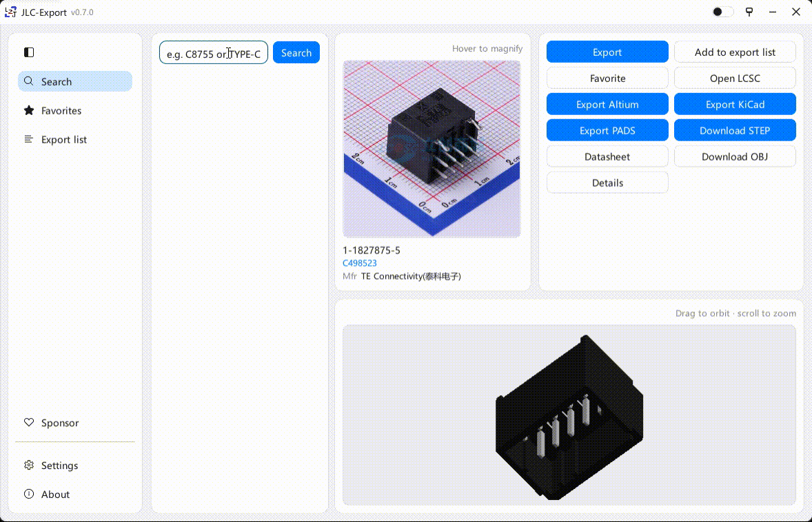

**语言：** [English](README.md) · **中文**

# 嘉立创导出工作站

发布版本：**0.9.0**。

| 中文 | English |
| --- | --- |
| 搜索立创器件，预览 3D（可嵌入封装），导出 Altium / KiCad / PADS 库和 STEP。 | Search LCSC parts, preview 3D (embeddable in footprints), and export Altium / KiCad / PADS libraries plus STEP. |
| 位号写入 Designator，型号写入 Comment，Description 可勾选规格和编号。 | Designator gets the prefix, Comment the MPN, and Description is a configurable template. |
| 用 Rust 编写。原生桌面程序，Windows 约 13 MB，内存占用低，没有 Electron，也不用额外运行时。 | Written in Rust. One small native binary (~13 MB on Windows), low memory use, no Electron or extra runtime. |
| 许可为 [CC BY-NC-4.0](https://creativecommons.org/licenses/by-nc/4.0/)。 | Licensed under [CC BY-NC-4.0](https://creativecommons.org/licenses/by-nc/4.0/). |



## 安装

从 [Releases](https://github.com/LZJ-I/JLC-Export-Workstation/releases) 下载对应系统的压缩包，解压后运行。更新时解压覆盖即可。软件内检查更新会按当前系统下载对应安装包并替换重启。

- Windows x64：`lceda-v*-x86_64-pc-windows-msvc.zip` → `lceda.exe`
- Linux x64：`lceda-v*-x86_64-unknown-linux-gnu.zip` → `lceda`
- macOS Apple Silicon：`lceda-v*-aarch64-apple-darwin.zip` → `lceda`
- macOS Intel：`lceda-v*-x86_64-apple-darwin.zip` → `lceda`

或从源码编译（需 [Rust](https://rustup.rs/)）：

```bash
cargo build --release -p lceda
```

## 图形界面

打开 `lceda.exe`（Windows）或 `lceda`（Linux / macOS）。默认把文件保存到「下载」文件夹下的 `lceda-out`，路径在 **设置** 里改。

每个器件一个子目录，名字是 `型号_立创编号_厂牌`，目录里的文件用型号命名。

左侧导航切换：**搜索**、**器件库**、**导出列表**、**赞助**、**设置**、**关于**。器件库的 **导入** 下拉提供 **导入 BOM… / 导入 AD 库… / 导入 KiCad 库…**。顶栏可拖动移动、双击最大化；窗口大小、分栏和主题会记住。

1. 在搜索框输入型号（如 `STM32F103C8T6`）或立创编号（如 `C8734`），回车或点「搜索」。双击一行可加入导出列表。
2. 启动时搜索框和器件预览为空，输入型号或立创编号后搜索。选中器件后，右侧顶部显示放大的器件图片、资源状态和操作按钮；下方使用一个完整的大画布，通过下拉框切换 **原理图 / 三维外形 / 封装**。切换项会记住；滚轮缩放、拖动预览，双击恢复视图。原理图直接读取实际 AD 导出记录，显示位号、型号和可见管脚文字，字体、字号及颜色沿用导出设置；封装显示实际焊盘、钻孔和外形。
3. 点 **导出…**，在同一勾选框中选择库文件、三维模型或 PDF，确认后写文件：
   - **下载 STEP / OBJ**：三维模型
   - **导出 AD 库**：`.SchLib` / `.PcbLib`（同时保留 EasyEDA JSON）
   - **导出 KiCad**：`.kicad_sym` 与 `.pretty`（有模型时写入 `.3dshapes` 并在封装中引用）
   - **导出 PADS**：`.c` 原理图 Decal、`.d` PCB Decal、`.p` Part Type（经典 Logic / Layout；Professional / Xpedition 不能当 Central Library）
   - **数据手册**：PDF。立创给的经常是 HTML 页，程序会从页面里取出真正的 PDF
   - **打开立创页**：国内站商品页（`item.szlcsc.com`）

资源不可用时，操作会禁用或提示原因。「下载资源」已合并到 **导出…**，可只选 STEP、OBJ 或 PDF。**详细信息** 和 **打开立创页** 是独立按钮；窄窗口中操作自动换行。

底栏“任务记录”按钮预留固定空间，较长保存路径不会挤挡按钮；点击可查看当前会话的搜索、导出和同步记录。

点 **加入器件库** 后选择目标库；只有一个库时也会显示选择框。**器件库** 保留原收藏分类管理（右键新建 / 改名 / 导入 / 导出 / 删除）。**导出列表** 可导入、导出或清空。

**合并本次器件到同一个库** 只出现在多个可合并器件的批量导出框里。单器件导出和全局设置不显示此项。导出生成独立副本，保存到输出目录；绑定库通过自动同步或“同步库”菜单更新。

**设置** 里可改语言、外观、保存目录、导出勾选预勾、3D 附带、封装改名，以及 **原理图颜色**（写入 Altium `.SchLib`）：

- **Altium 经典**（默认）：外形和管脚暗红（`COLOR=128`），位号 / 型号蓝色，管脚字黑色
- **立创官方**：商城符号预览——暗红框 `#880000`，普通脚蓝字，电源红、地黑（输入/输出不再另配色）
- **黑白**：适合打印
- **自定义**：逐项选色，旁边有预览

3D 两项默认开启（没有模型则跳过）。封装名默认保持立创原名，需要再勾选改名。

**设置 → 导出 → Description** 使用左右结构：左侧勾选和拖动排序，右侧查看器件的 Designator / Comment / Description。预览默认加载 10kΩ 电阻（C25804），修改勾选立即更新，也可查询其他器件。

**赞助** 的收款码来自共用仓库 [LZJ-I/sponsor](https://github.com/LZJ-I/sponsor)，GitHub 赞助入口也只挂这一处。

导出 AD / KiCad / PADS 时会同时留下 EasyEDA JSON，供对照，不必单独再导一遍。

### BOM 导入器件库

在 **器件库 → 导入 → 导入 BOM…** 选择 CSV / TSV / Excel（xlsx、xls、xlsb、ods）和目标器件库，保留数量和位号。先匹配，再核对候选的型号、厂商和封装；「确认编号一致项」只确认与源表 C 编号完全一致的结果，并保留已手动选择的替代器件。仅有型号的行需要手动选择。所有包含的行确认后，点 **加入此器件库**；也可排除不需要的行。匹配使用最多 4 个工作线程，相同查询只请求一次，保留原表顺序，支持进度、取消和失败重试；取消会等待正在进行的请求结束，已完成结果保留。

器件库沿用原收藏及分类。此前新增的独立本地搜索、备注和资料管理界面已移除；旧收藏、设置及内部预览缓存继续保留。目前在线搜索源仍为立创。

### 导入现有 AD / KiCad 库

在 **器件库 → 导入** 选择 `.SchLib` 或 `.kicad_sym`。确认窗口左侧搜索、勾选器件，右侧预览原库符号；确认后按文件名创建器件库，也可填写其他名称。取消不会保存器件或复制资源。

导入保留名称、描述、参数、封装关联和全部单元；器件页可切换多单元、查看详细信息，按名称、描述或封装筛选。程序保存内部副本，源文件保持不变；同一路径再次导入会更新原记录，不重复新增。AD 支持原生库中的中文、混合编码和名称映射；KiCad 保留继承依赖。

导入默认不搜索、不下载、不修改任何原有符号、封装或 3D 绑定。底部的 **导入后可选补全 → 封装 / 3D 模型** 默认均不勾选；可选全部导入器件或当前预览器件。勾选后也只在导入完成时打开补全窗口，仍需搜索并确认候选才会下载。

**导出原格式…** 和器件库的单器件 / 整库导出都可导出这些器件，保留原格式及已有的同名配套 `.PcbLib`、`.pretty`、`.3dshapes`。当前不转换现有库的格式，不编辑其符号，也不解析配套库的封装 / 3D 预览。原库器件使用独立本地标识，名称像 C2040 也不会误查成立创器件。绑定同步更新此分类中另行加入的立创器件；刷新导入的原库器件请重新导入源文件。

### 可选补充封装和 3D

导入后可从 **补全资源 → 补全当前器件 / 补全整个器件库**，或器件卡片、右键菜单进入。选择全部或单个器件，再选择只补封装、只补 3D 或两者；输入完整型号 / C 编号，搜索候选并核对来源、厂商、封装和预览。**确认唯一精确匹配** 是可选的人工确认操作；普通搜索不会自动确认或下载，已确认的其他器件不会被批量重试覆盖。

补充资源保存为独立文件，不合并到原 `.PcbLib` / `.pretty`，不更改原封装列表、当前封装、引脚映射、3D 位置或现有工程。新封装使用独立名称；只补 3D 时仅保存 STEP 和可用的 OBJ 预览，不建立新封装。来源缺少可下载 STEP 时提示失败，保留原有资源。下载和搜索最多 4 个工作线程，每个器件独立保存；原库器件页可分别查看补充封装和 3D，并显示资源来源。

原格式导出可选择 **附带已补充资源（保持原绑定）**，在 `Resources/` 中保存独立封装、模型和来源清单。两者一起补充时，新的 AD 封装内嵌 STEP，新的 KiCad 封装引用配套 STEP；原符号仍使用原关联。使用这些资源替换原关联需要在 EDA 中明确选择并核对，软件不会自动改绑。软件目前仍使用立创器件资源搜索，不是通用多站封装 / 3D 搜索。

### 器件库导出与绑定同步

器件库顶部 **导出…** 提供 **导出选中器件… / 导出当前器件库…**，直接选择格式并生成独立文件，无需加入导出列表。切换器件库时，右侧预览同步切到库内器件；空库清空预览。导出确认框固定本次器件清单，并显示编号、数量和实际保存路径。整库导出只包含当前分类，每次保存到独立的 `Library-库名-编号` 目录，避免与搜索器件或以前的导出文件混在一起；多个器件可合并为一个库。

顶部 **同步库** 下拉可同步当前库的全部绑定、仅 AD、仅 KiCad，或同步所有器件库。右键器件库也有同样操作。通过 **绑定库文件… → AD / KiCad** 选择现有或新建文件，每个器件库可各绑定一套 AD 和 KiCad 库，同一格式的同一个文件不允许绑定多个器件库：

Windows 的 **同步库 → 连接 AD… → 安装原生插件** 使用本机 AD 配套 SDK 编译安装；关闭 AD 后安装，重新启动 AD 自动后台连接，不需要脚本窗口。缺少 SDK 或版本接口不兼容时明确报错，不改动库。**设置 → 常规 → AD 原生插件** 提供卸载按钮、安装状态和处理结果，卸载保留器件库及绑定关系。连接窗口也支持卸载、文件模式与脚本兼容方式。[插件安装说明及验证边界](integrations/altium/plugin/README_ZH.md)。

同步由 AD 追加、保存、重新打开并读回器件，工作站还检查保存后的符号、封装和 STEP。新符号使用 `型号_C编号`；已有器件、封装、3D 和关联保留，目标库有未保存修改时停止。AD 关闭时任务等待连接，并保存待同步的器件库范围；重启后重新核对当前绑定。失败或超时的写入需手动重试，不自动重放，不退回直接覆盖文件。文件模式须关闭 AD，结果标明未在 AD 内验证。Linux 和 KiCad 保持文件同步。[脚本兼容方式](integrations/altium/README_ZH.md)。

- **AD**：选择 `.SchLib`，配套使用同目录同名 `.PcbLib`。文件同步以 C 编号命名和更新，型号保留在 Comment；编辑器连接按上述规则追加并保留已有器件。已有其他器件、字体、模型和附加流保留。
- **KiCad**：选择 `.kicad_sym`，配套使用同名 `.pretty/` 和 `.3dshapes/` 目录。符号、封装和模型以 C 编号命名，Value 保留型号，符号的封装字段使用“库文件名:C编号”。生成格式为 **KiCad 9**；较旧符号库会升级格式版本，未修改的原有符号及未知字段保留。

加入器件、导入 BOM 或修改描述、颜色和 3D 等导出设置后自动同步，沿用原有设置。移除器件或解除绑定保留外部库文件中的器件。导出副本保存到输出目录，并检查路径，避免与绑定库冲突。

绑定文件的检查在后台运行。点击 **绑定并同步** 或手动同步后立即打开 **库同步进度**，显示当前器件、目标文件、已处理数量及逐项失败原因。可 **转到后台** 继续使用界面，从底栏或同步库菜单重新查看。**停止剩余任务** 会等当前器件处理结束，保留已完成的写入；失败或停止的任务可在进度窗口重新同步。

两种同步都有文件锁、备份和中断恢复；上一版备份为同目录隐藏的 `.文件名.jlc-backup`。Windows 本地目录和 WSL 共享路径均已验证同步与重试；文件占用和路径、权限错误分别提示，替换失败保留原文件。KiCad 另有 `.文件名.jlc-meta.json` 归属记录，需要随库一起保留。已有同名但未被本工具管理的 KiCad 器件，或管理的器件已被手工修改时，会提示冲突并保留原件；可先备份并改用新库文件。同步失败会显示原因，也可通过下拉重试。

AD 中将这对文件库安装一次。KiCad 中分别添加符号库文件和 `.pretty` 封装库，昵称使用库文件名（不含扩展名）；3D 引用使用绑定位置的绝对路径。后续同步更新原路径，EDA 软件可能需要刷新或重新打开库。此版本不自动修改 KiCad 全局/工程库表，也不自动向当前原理图放置器件。

详见 [KiCad 绑定实现与验证](docs/KICAD_BINDING_ASSESSMENT_ZH.md)。已移除旧的全局固定 AD 库同步设置。

快捷键：`Ctrl+F` 搜索，`Ctrl+O` 导入 BOM，`Ctrl+Enter` 打开导出确认框。

### 批量文件

每行一个型号或立创编号，`#` 或 `//` 开头为注释。界面里点「批量文件…」会先弹出勾选框，可只导出其中几种（例如只要 PADS，或只要 AD）。

```
# 例子
C8734
STM32F030C8T6
C2040
```

## 命令行

无参数打开图形界面。

```bash
lceda search C2040
lceda get C2040 --step --ad --kicad --pads -o ./out
lceda get C2040 --kicad --no-kicad-3d -o ./out
lceda get C2040 --ad --no-ad-3d -o ./out
lceda get C2040 --ad --rename-footprint -o ./out
lceda get C2040 --ad --sch-color altium -o ./out
lceda get C2040 --ad --ad-library-file ./MyParts.SchLib -o ./out
lceda get C2040 --kicad --kicad-library-file ./MyParts.kicad_sym -o ./out
lceda get C2040 --source -o ./out
lceda get C2040 --datasheet -o ./out
lceda batch ids.txt --ad --kicad --pads --step -o ./out
lceda --lang zh gui
```

`batch` 文本文件格式与上面相同；命令行用 `--ad` / `--kicad` / `--pads` 等开关选择类型。`--sch-color` 可选 `altium`（默认）、`easyeda`、`mono`。命令行没写时，若设置里是自定义，会用你保存的那套颜色。

## 说明

导出结果请在 Altium / KiCad / PADS 中核对后再使用。本工具使用立创非官方接口，可能随时变化。

## 关于

- 作者：[LZJ-I](https://github.com/LZJ-I)
- 仓库：[LZJ-I/JLC-Export-Workstation](https://github.com/LZJ-I/JLC-Export-Workstation)
- 许可：[CC BY-NC-4.0](https://creativecommons.org/licenses/by-nc/4.0/)

有帮助的话，欢迎点一下 Star。[](https://github.com/LZJ-I/JLC-Export-Workstation)
